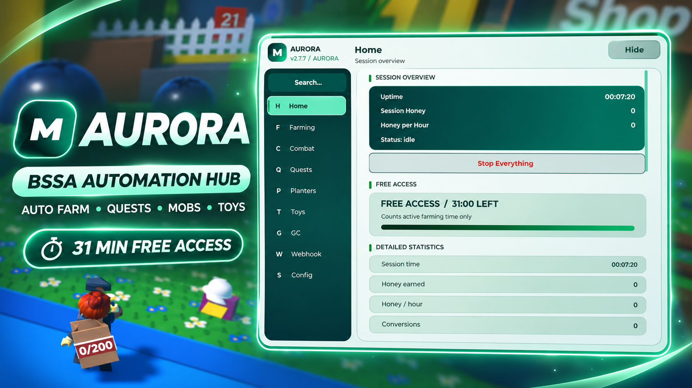
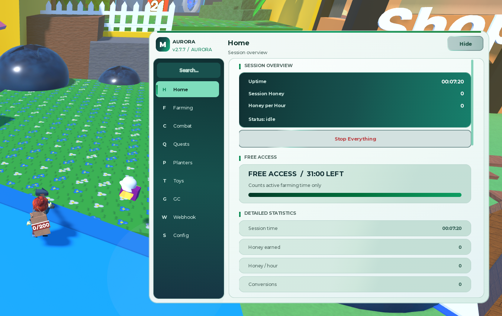
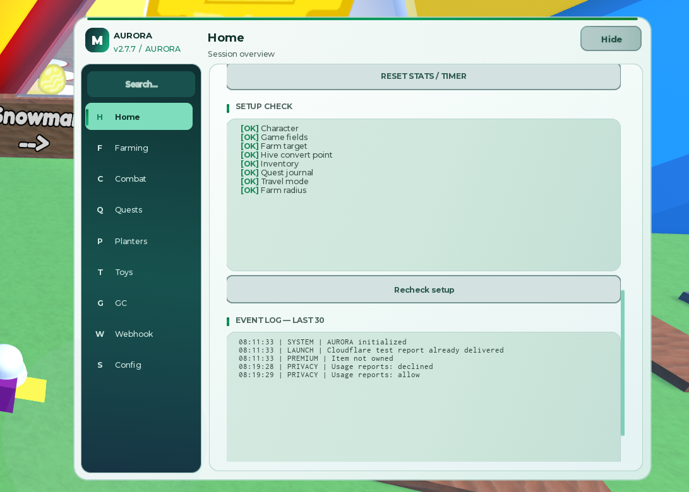

<div align="center">



# AURORA

**BSSA Automation Hub · Clean interface · Configurable workflows**

[](https://www.roblox.com/games/138981531711632)


[](https://scriptblox.com/script/X2-POLLENBee-Swarm-Simulator-Ascended-BSSA-MACRO-237346)

**[English](#english) · [Русский](#russian) · [Get started](#launch--english) · [Features](#features--english)**

*Independent fan-made project. Not affiliated with or endorsed by Roblox or the game developers.*

</div>

---

<a id="english"></a>
## English

### Everything in one organized hub

**AURORA** is a configurable third-party automation interface for **Bee Swarm Simulator Ascended (BSSA)**. Manage farming, token collection, hive conversion, quests, mobs, selected items and session data from a single mint-and-teal dashboard.

> **31 minutes of free active farming** to explore the features. Trial usage is cumulative across sessions. **Lifetime Premium** requires ownership of a designated **65 Robux UGC item**; no recurring subscription.

<a id="launch--english"></a>
### Quick start

1. Open the supported game.
2. Use the loader in an environment where its functions are supported.
3. Complete the in-app setup: select your field and set the hive conversion point.
4. Check **Setup Check**, then start farming.

```lua
loadstring(game:HttpGet("https://is.gd/GUogOl"))()
```

*Loader compatibility depends on the execution environment. Mobile support is not verified. Solara and Xeno have not been tested.*

<a id="features--english"></a>
### Feature overview

| Area | Included capabilities |
|:---|:---|
| **Farming** | Configurable auto farming, selected fields, pollen and token collection |
| **Conversion** | Automatic return to hive at chosen backpack capacity |
| **Movement** | Tween/field travel options, WalkSpeed, TweenSpeed and configurable search radii |
| **Boosts** | Field boosting, timers, cooldowns and optional field restrictions |
| **Quests · Premium** | Selected NPC quest completion and separate completed-quest hand-in |
| **Combat · Premium** | Mob targeting, cooldowns, configurable boss locations and movement patterns |
| **Items** | Free Sprinkler management; selected automatic consumables require Premium |
| **Statistics** | Session duration, honey, hourly rate, conversions, tokens and activity logs |
| **Utilities** | Setup Check, settings persistence, import/export, anti-AFK option, Stop Everything |

> **Not implemented:** the **Planters** and **Glitch Challenge (GC)** tabs are placeholders, not finished automation features.

### Interface preview

<div align="center">
<table>
<tr>
<td width="50%"></td>
<td width="50%"></td>
</tr>
<tr><td align="center"><sub>HOME · Session overview & trial</sub></td><td align="center"><sub>SETUP · Diagnostics & event log</sub></td></tr>
</table>
</div>

### Free access and Premium

| | Free trial | Lifetime Premium |
|:--|:--|:--|
| Duration | **31 minutes** of qualifying active farming, cumulative | No trial countdown |
| Payment | Free | **One-time 65 Robux UGC purchase** |
| Access | Test available features during the trial | Continue access after trial expiration |
| Ownership | Not required for trial | Roblox item ownership check |

**[View Premium UGC](https://www.roblox.com/catalog/93446334288846/Korblox-Emo-Slender-Girl-Avatar-Headles-Y2K-Blox)** · **[Visit Fit Flip](https://www.roblox.com/games/135556895866044/FIT-FLIP-Avatar-Outfit-Mall)**

The item is published through the developer's Roblox account; Fit Flip belongs to the developer's group. Qualifying in-experience purchases may generate Robux for both. Buying the item is not guaranteed to make the loader compatible with every environment.

### Privacy and project status

- First-launch and usage analytics are **optional and require consent**; declining analytics does not block the interface.
- Trial progress and configuration are stored locally. Client-side integrity checks are not tamper-proof.
- **Information-only distribution:** no individual setup support, bug-report inbox, feature-request queue or troubleshooting service.
- Third-party automation can conflict with game/platform rules. Use only where permitted; account and compatibility risks are yours to evaluate.

---

<a id="russian"></a>
## Русский

### Всё в одном интерфейсе

**AURORA** — настраиваемый сторонний интерфейс автоматизации для **Bee Swarm Simulator Ascended (BSSA)**. В едином мятно-зелёном меню собраны фарм, сбор токенов, конвертация мёда, квесты, мобы, предметы и подробная статистика.

> **31 минута бесплатного активного фарма** для знакомства с возможностями. Использованное время сохраняется между запусками. **Бессрочный Premium** открывается при наличии специального **UGC за 65 Robux**, без подписки.

### Быстрый запуск

1. Зайдите в поддерживаемую игру.
2. Используйте загрузчик в среде, где поддерживаются необходимые функции.
3. В AURORA выберите поле и укажите точку конвертации у улья.
4. Убедитесь, что **Setup Check** не показывает ошибок, и запускайте фарм.

```lua
loadstring(game:HttpGet("https://is.gd/GUogOl"))()
```

*Работа загрузчика зависит от среды исполнения. Мобильная версия не проверена. Solara и Xeno не тестировались.*

### Возможности

| Раздел | Функции |
|:---|:---|
| **Farming** | Фарм выбранных полей, сбор пыльцы и токенов, параметры маршрута |
| **Conversion** | Возврат к улью при заданном заполнении рюкзака |
| **Movement** | Tween, скорость ходьбы и перемещения, радиусы и границы полей |
| **Boosts** | Бустеры полей, кулдауны, таймеры и ограничения по полям |
| **Quests · Premium** | Автовыполнение квестов выбранных NPC и отдельная автоматическая сдача |
| **Combat · Premium** | Мобы, отслеживание откатов, точки и маршруты для боссов |
| **Items** | Sprinkler доступен бесплатно; часть автоматизации расходников требует Premium |
| **Statistics** | Длительность сессии, мёд, скорость заработка, конвертации и журнал событий |
| **Utilities** | Проверка настроек, сохранение конфига, импорт/экспорт, Stop Everything |

> **Важно:** вкладки **Planters** и **GC (Glitch Challenge)** пока являются заготовками. Эти функции не реализованы.

### Скриншоты интерфейса

<div align="center">
<table>
<tr>
<td width="50%"></td>
<td width="50%"></td>
</tr>
<tr><td align="center"><sub>HOME · Статистика и пробный период</sub></td><td align="center"><sub>SETUP · Проверка и журнал событий</sub></td></tr>
</table>
</div>

### Бесплатно и Premium

| | Пробный период | Premium навсегда |
|:--|:--|:--|
| Доступ | **31 минута** активного фарма суммарно | Без ограничения пробным периодом |
| Стоимость | Бесплатно | **65 Robux, один раз** |
| Условие | Для пробы UGC не нужен | Требуется владение определённым UGC |
| Проверка | Таймер с сохранением прогресса | Проверка наличия предмета Roblox |

**[UGC для Premium](https://www.roblox.com/catalog/93446334288846/Korblox-Emo-Slender-Girl-Avatar-Headles-Y2K-Blox)** · **[Магазин Fit Flip](https://www.roblox.com/games/135556895866044/FIT-FLIP-Avatar-Outfit-Mall)**

UGC опубликован на аккаунте разработчика, Fit Flip принадлежит группе разработчика. Покупки внутри плейса могут приносить Robux обеим сторонам. Покупка Premium не гарантирует работу скрипта в любой среде.

### Конфиденциальность и поддержка

- Аналитика первого запуска и использования **добровольная**, отправляется с согласия. Отказ не блокирует интерфейс.
- Настройки и время пробного периода сохраняются локально. Проверка целостности не равна полноценной криптографической защите.
- **Репозиторий — информационная витрина:** индивидуальной техподдержки, приёма жалоб, предложений и разбора ошибок нет.
- Сторонняя автоматизация может противоречить правилам игры или платформы. Используйте только там, где это разрешено, и учитывайте риски для аккаунта.

---

<div align="center">

**AURORA · BSSA Automation Hub**

*Discover features. Configure your workflow. Keep everything in one place.*

</div>
